# Práctica 1.6 - Instalación de WordPress en una instancia EC2 de AWS

**Módulo:** Implantación de Aplicaciones Web
**Curso:** 2026/2027
**Alumno:** Javi

En esta práctica se automatiza con scripts de Bash la instalación de **WordPress** en una instancia **EC2 de AWS**, sobre una pila **LAMP** (Linux, Apache, MySQL y PHP) y con **HTTPS** mediante un certificado de **Let's Encrypt**.

Se hacen las dos formas de instalación que pide la práctica:

- **En el directorio raíz** de Apache: `/var/www/html`
- **En su propio directorio**: `/var/www/html/wordpress`, pero accediendo desde la raíz del dominio.

---

## Índice

1. [¿Qué es un CMS y qué es WordPress?](#1-qué-es-un-cms-y-qué-es-wordpress)
2. [Estructura del repositorio](#2-estructura-del-repositorio)
3. [Creación de la instancia EC2](#3-creación-de-la-instancia-ec2)
4. [Variables de entorno (.env)](#4-variables-de-entorno-env)
5. [Instalación de la pila LAMP](#5-instalación-de-la-pila-lamp)
6. [Certificado HTTPS con Let's Encrypt](#6-certificado-https-con-lets-encrypt)
7. [Instalación de WordPress en el directorio raíz](#7-instalación-de-wordpress-en-el-directorio-raíz)
8. [Instalación de WordPress en su propio directorio](#8-instalación-de-wordpress-en-su-propio-directorio)
9. [Security keys](#9-security-keys)
10. [Problemas encontrados](#10-problemas-encontrados)
11. [Orden de ejecución](#11-orden-de-ejecución)
12. [Referencias](#12-referencias)

---

## 1. ¿Qué es un CMS y qué es WordPress?

Un **Sistema de Gestión de Contenidos (CMS)** es un software que permite crear, editar y gestionar el contenido de una web de forma sencilla, sin tener que programar cada página. Algunos ejemplos son WordPress, Joomla y Drupal.

**WordPress** es el CMS más utilizado para crear webs y blogs. Es software libre, está hecho en PHP, guarda los datos en MySQL y tiene muchísimos plugins y temas para añadir funciones y cambiar el diseño.

---

## 2. Estructura del repositorio

```
.
├── README.md
├── .gitignore
├── conf
│   ├── 000-default.conf               # VirtualHost por defecto de Apache
│   └── virtualhost.conf.template      # Plantilla del VirtualHost de nuestro dominio
├── htaccess
│   └── .htaccess                      # Reglas para los enlaces permanentes de WordPress
├── img                                # Capturas de pantalla del README
├── php
│   └── index.php                      # Página de prueba con phpinfo()
└── scripts
    ├── .env.example                   # Plantilla con las variables de configuración
    ├── install_lamp.sh
    ├── setup_letsencrypt_https.sh
    ├── deploy_wordpress_root_directory.sh
    └── deploy_wordpress_own_directory.sh
```

El archivo `scripts/.env` con los datos reales **no se sube al repositorio** porque contiene contraseñas (está en el `.gitignore`). En su lugar se sube `.env.example`.

---

## 3. Creación de la instancia EC2

Desde la consola de AWS Academy se crea una instancia EC2 con esta configuración:

- **AMI:** Ubuntu Server (última versión).
- **Par de claves:** `vockey` (el que da AWS Academy) para conectarse por SSH.

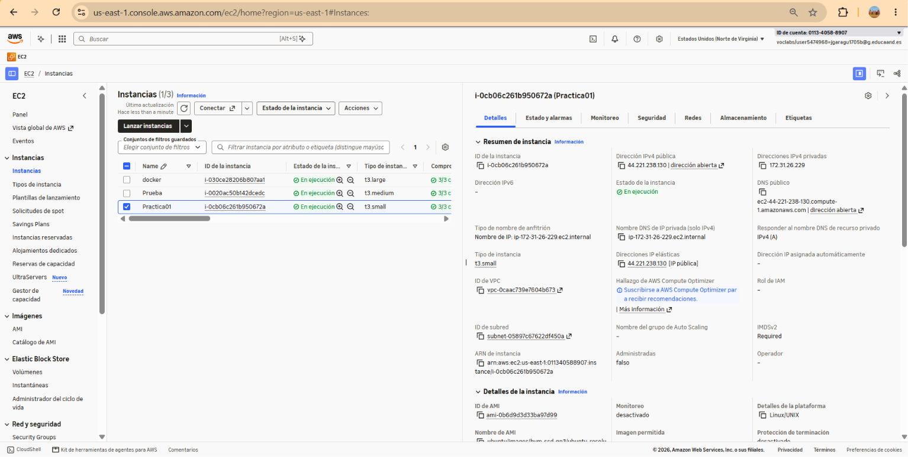

Se configura un **grupo de seguridad** con estos puertos abiertos:

| Puerto | Protocolo | Para qué sirve |
|---|---|---|
| 22 | TCP | SSH (conectarnos a la máquina) |
| 80 | TCP | HTTP |
| 443 | TCP | HTTPS |

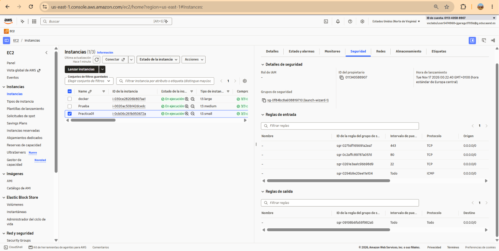

Después se crea una **IP elástica** y se asocia a la instancia, para que la IP pública no cambie cada vez que se para y se arranca la máquina. El dominio `practica-daw.ddnsking.com` (No-IP) apunta a esta IP.

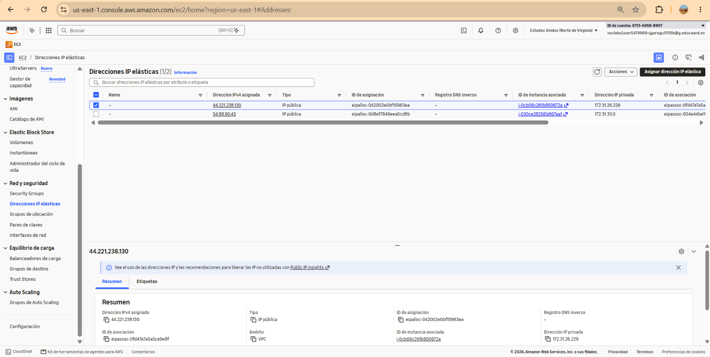

Para conectarnos por SSH:

```bash
ssh -i vockey.pem ubuntu@IP_ELASTICA
```

Y clonamos el repositorio en la instancia:

```bash
git clone https://github.com/jgaragu1705/practica-1-6.git
cd practica-1-6
```

---

## 4. Variables de entorno (.env)

Todos los scripts leen su configuración del archivo `scripts/.env`. Se crea a partir de la plantilla:

```bash
cp scripts/.env.example scripts/.env
nano scripts/.env
```

| Variable | Para qué sirve |
|---|---|
| `LETS_ENCRYPT_DOMAIN` | Dominio de la web (para el certificado y las URLs de WordPress) |
| `LETS_ENCRYPT_EMAIL` | Email para avisos de Let's Encrypt |
| `DB_NAME` | Nombre de la base de datos de WordPress |
| `DB_USER` | Usuario de MySQL para WordPress |
| `DB_PASSWORD` | Contraseña de ese usuario |
| `DB_HOST` | Dónde está MySQL (`localhost`, porque está en la misma máquina) |
| `IP_CLIENTE_MYSQL` | Desde dónde se puede conectar el usuario (`localhost`, `%`, una IP...) |
| `WORDPRESS_TITLE` | Título del sitio |
| `WORDPRESS_ADMIN_USER` | Usuario administrador de WordPress |
| `WORDPRESS_ADMIN_PASSWORD` | Contraseña del administrador |
| `WORDPRESS_ADMIN_EMAIL` | Email del administrador |
| `URL_HIDE_LOGIN` | Ruta personalizada para el login (en vez de `/wp-admin`) |

Los scripts apagan `set -x` mientras cargan el `.env` y en los comandos que llevan contraseñas, para que no salgan por pantalla.

---

## 5. Instalación de la pila LAMP

**Script:** `scripts/install_lamp.sh`

```bash
sudo ./scripts/install_lamp.sh
```

Qué hace:

1. Actualiza los repositorios con `apt update`.
2. Instala **Apache** y copia nuestro `000-default.conf`.
3. Activa el módulo **`mod_rewrite`** (`a2enmod rewrite`), que necesitan los enlaces permanentes de WordPress.
4. Instala **PHP** con `libapache2-mod-php` y `php-mysql`.
5. Instala las extensiones de PHP que recomienda WordPress: `php-curl`, `php-gd`, `php-xml`, `php-mbstring`, `php-zip` y `php-intl`.
6. Instala **MySQL Server**.
7. Copia un `index.php` con `phpinfo()` para comprobar que PHP funciona.
8. Cambia el propietario de `/var/www/html` a `www-data` y reinicia Apache.

En el `000-default.conf` es importante la directiva **`AllowOverride All`**, que permite a Apache leer el archivo `.htaccess`:

```apache
<Directory /var/www/html>
  AllowOverride All
</Directory>
```

Para comprobar las extensiones de PHP:

```bash
php -m | grep -E "curl|gd|xml|mbstring|zip|intl"
```

---

## 6. Certificado HTTPS con Let's Encrypt

**Script:** `scripts/setup_letsencrypt_https.sh`

```bash
sudo ./scripts/setup_letsencrypt_https.sh
```

Qué hace:

1. Instala **Certbot** con `snap`.
2. Deshabilita los VirtualHost por defecto (`000-default` y `default-ssl`).
3. Crea el VirtualHost de nuestro dominio a partir de `conf/virtualhost.conf.template` usando **`envsubst`**, que cambia `${LETS_ENCRYPT_DOMAIN}` y `${LETS_ENCRYPT_EMAIL}` por sus valores del `.env`.
4. Habilita el nuevo VirtualHost y reinicia Apache.
5. Pide el certificado con Certbot:

```bash
certbot --apache \
  -m "$LETS_ENCRYPT_EMAIL" \
  --agree-tos \
  --no-eff-email \
  -d "$LETS_ENCRYPT_DOMAIN" \
  --non-interactive \
  --redirect \
  --keep-until-expiring
```

- `--redirect`: redirige todo el tráfico HTTP a HTTPS.
- `--keep-until-expiring`: si ya hay un certificado válido lo reutiliza. Así no se piden certificados nuevos cada vez que se ejecuta el script (Let's Encrypt limita a 5 certificados iguales por semana).

Certbot crea el archivo `practica-daw.ddnsking.com-le-ssl.conf` (VirtualHost del puerto 443) copiando nuestro VirtualHost, así que también lleva el `AllowOverride All`.

Certificado válido visto desde el navegador:

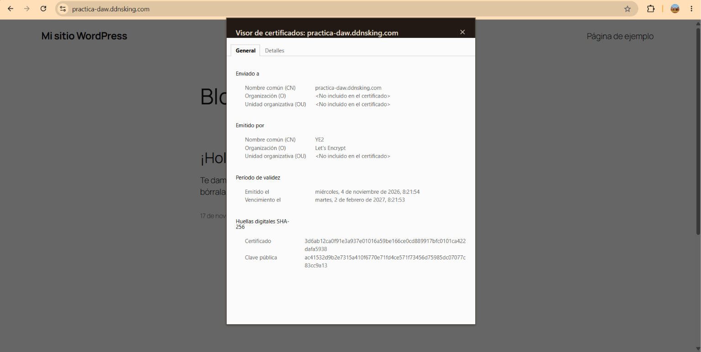

Y desde la terminal con `sudo certbot certificates`:

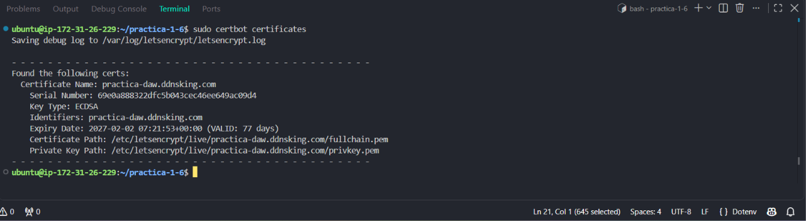

---

## 7. Instalación de WordPress en el directorio raíz

**Script:** `scripts/deploy_wordpress_root_directory.sh`

```bash
sudo ./scripts/deploy_wordpress_root_directory.sh
```

En vez de configurar WordPress a mano con `sed`, se usa **WP-CLI**, la herramienta oficial para gestionar WordPress desde la terminal.

Qué hace:

1. **Descarga WP-CLI** y lo deja en `/usr/local/bin/wp`.
2. **Borra instalaciones anteriores** de `/var/www/html` (también el `.htaccess`, que al estar oculto no lo borra el `*`).
3. **Descarga WordPress en español** y lo descomprime en `/var/www/html`. Se usa `--strip-components=1` para quitar la carpeta `wordpress/` que trae el `.tar.gz` y dejar los archivos directamente en la raíz.
4. **Crea la base de datos y el usuario** de MySQL con sus privilegios:

```bash
mysql -u root -e "CREATE DATABASE $DB_NAME"
mysql -u root -e "CREATE USER '$DB_USER'@'$IP_CLIENTE_MYSQL' IDENTIFIED BY '$DB_PASSWORD'"
mysql -u root -e "GRANT ALL PRIVILEGES ON $DB_NAME.* TO '$DB_USER'@'$IP_CLIENTE_MYSQL'"
```

5. **Crea el `wp-config.php`** con los datos de la base de datos (`wp config create`).
6. **Instala WordPress** con el título y el usuario administrador (`wp core install`), usando `https://` en la URL.
7. **Configura los enlaces permanentes** como `/%postname%/` (`wp rewrite structure`).
8. **Copia el `.htaccess`** a `/var/www/html`. Hace falta porque `wp rewrite` no puede crearlo desde la terminal (no detecta que Apache tiene `mod_rewrite`).
9. **Instala el plugin WPS Hide Login** y cambia la URL del login a `/acceso-privado`, para que no se pueda entrar por `/wp-admin` ni `/wp-login.php`.
10. Cambia el propietario de todo a `www-data`.

Final de la ejecución del script:

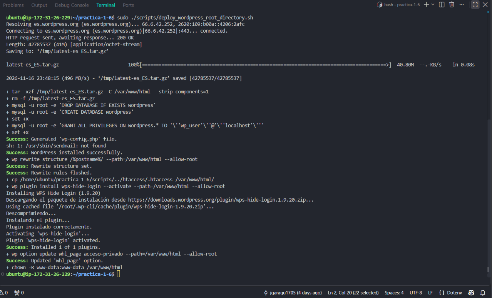

### El archivo .htaccess

```apache
# BEGIN WordPress
<IfModule mod_rewrite.c>
RewriteEngine On
RewriteBase /
RewriteRule ^index\.php$ - [L]
RewriteCond %{REQUEST_FILENAME} !-f
RewriteCond %{REQUEST_FILENAME} !-d
RewriteRule . /index.php [L]
</IfModule>
# END WordPress
```

- `RewriteEngine On`: activa la reescritura de URLs.
- `RewriteBase /`: la ruta base para las reglas.
- `RewriteRule ^index\.php$ - [L]`: si piden `index.php` no se hace nada y no se miran más reglas.
- `RewriteCond ... !-f` y `!-d`: comprueban que lo que se pide **no** es un archivo ni una carpeta que exista.
- `RewriteRule . /index.php [L]`: si se cumplen las dos condiciones, la petición se manda a `index.php` y WordPress decide qué página mostrar.

### Comprobaciones

Portada de WordPress en `https://practica-daw.ddnsking.com`:

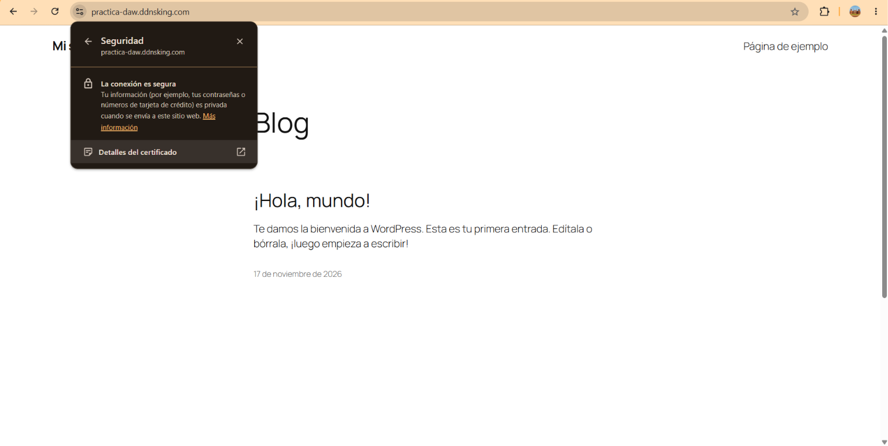

Los enlaces permanentes funcionan, por ejemplo `https://practica-daw.ddnsking.com/hola-mundo/`:

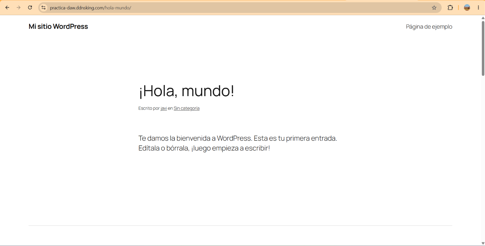

El login está en la ruta personalizada `https://practica-daw.ddnsking.com/acceso-privado`:

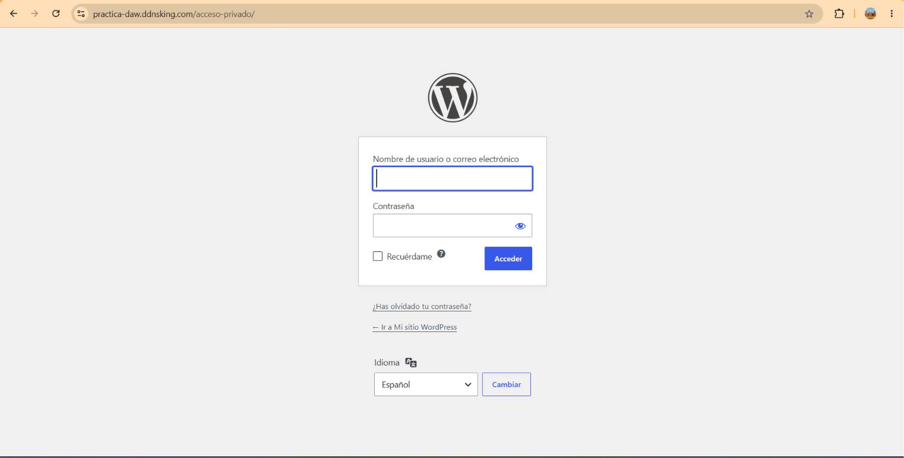

Y si se intenta entrar por `/wp-admin` sin haber iniciado sesión, no aparece el login:

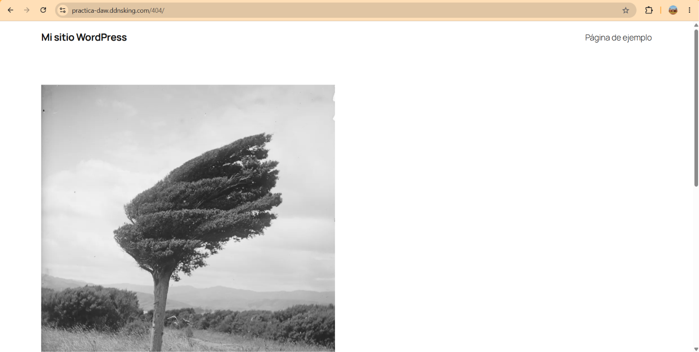

---

## 8. Instalación de WordPress en su propio directorio

**Script:** `scripts/deploy_wordpress_own_directory.sh`

```bash
sudo ./scripts/deploy_wordpress_own_directory.sh
```

Aquí el código de WordPress va en `/var/www/html/wordpress`, pero los visitantes entran por `https://practica-daw.ddnsking.com`, sin `/wordpress` en la URL. Así la raíz del servidor queda más limpia.

Los pasos son los mismos que en la instalación en la raíz, pero con `--path=/var/www/html/wordpress`, y además:

### WP_SITEURL y WP_HOME

Se añaden dos constantes al `wp-config.php`:

| Constante | Valor | Significado |
|---|---|---|
| `WP_SITEURL` | `https://practica-daw.ddnsking.com/wordpress` | Dirección de WordPress: dónde está el código |
| `WP_HOME` | `https://practica-daw.ddnsking.com` | Dirección del sitio: la URL que usan los visitantes |

```bash
wp config set WP_SITEURL "https://$LETS_ENCRYPT_DOMAIN/wordpress" --path=$WP_DIR --allow-root
wp config set WP_HOME "https://$LETS_ENCRYPT_DOMAIN" --path=$WP_DIR --allow-root
```

Se usa `wp config set` en lugar de `sed` porque hace lo mismo pero es más fácil de leer.

### index.php en la raíz

Se copia el `index.php` de WordPress a `/var/www/html` y se le cambia la ruta con `sed`:

```bash
cp /var/www/html/wordpress/index.php /var/www/html/
sed -i "s#wp-blog-header.php#wordpress/wp-blog-header.php#" /var/www/html/index.php
```

Así queda la última línea:

```php
require __DIR__ . '/wordpress/wp-blog-header.php';
```

Cuando alguien entra en la raíz del dominio, Apache ejecuta este `index.php`, que carga el WordPress que está dentro de la carpeta `wordpress`. En `sed` se usa `#` como separador porque la ruta lleva `/`.

### .htaccess en la raíz

El `.htaccess` se copia a `/var/www/html` y no a la subcarpeta, porque las peticiones llegan a la raíz y ahí es donde está el `index.php`.

### Comprobaciones

La raíz del servidor solo tiene el `.htaccess`, el `index.php` y la carpeta `wordpress`. También se ve la línea del `require` y las dos constantes del `wp-config.php`:

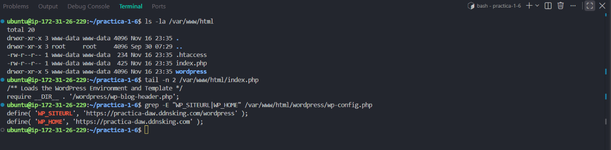

La portada se ve desde la raíz del dominio, sin `/wordpress` en la URL:

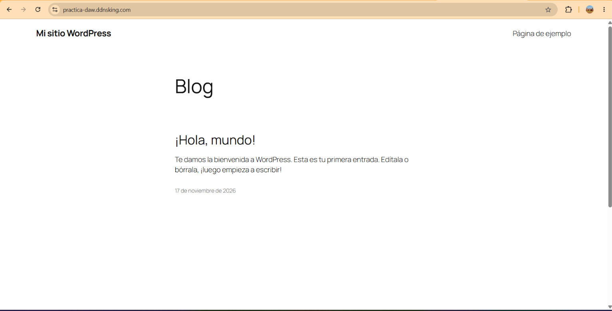

En **Ajustes → Generales** se ven las dos direcciones en gris (no se pueden editar), porque están fijadas en el `wp-config.php`:

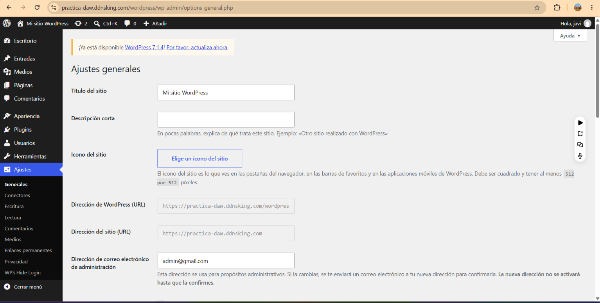

---

## 9. Security keys

El `wp-config.php` tiene unas **security keys** (`AUTH_KEY`, `SECURE_AUTH_KEY`, `LOGGED_IN_KEY`, `NONCE_KEY` y sus `SALT`) que sirven para cifrar las cookies y las sesiones. Cada instalación debe tener unas claves únicas.

En el enunciado se generan llamando a la API de WordPress (`https://api.wordpress.org/secret-key/1.1/salt/`) y se añaden con `sed`. En esta práctica no hace falta, porque **`wp config create` las genera automáticamente** al crear el `wp-config.php`.

Para comprobarlo:

```bash
sudo grep -E "AUTH_KEY|NONCE_SALT" /var/www/html/wp-config.php
```

---

## 10. Problemas encontrados

- **`wp core download --locale=es_ES` fallaba** en el servidor, así que WordPress en español se descarga directamente con `wget` desde `https://es.wordpress.org/latest-es_ES.tar.gz`.
- **Los enlaces permanentes daban 404**, porque `wp rewrite structure` no crea el `.htaccess` desde la terminal. Se soluciona copiando nuestro `.htaccess`.
- **`set -x` mostraba las contraseñas** del `.env` por pantalla. Se soluciona apagándolo con `set +x` en esas partes.
- **Aviso `sendmail: not found`** al instalar WordPress: WordPress intenta mandar un correo al administrador y el servidor no tiene ningún programa de correo. No afecta a la instalación.

---

## 11. Orden de ejecución

```bash
sudo ./scripts/install_lamp.sh
sudo ./scripts/setup_letsencrypt_https.sh

# Y uno de estos dos:
sudo ./scripts/deploy_wordpress_root_directory.sh
sudo ./scripts/deploy_wordpress_own_directory.sh
```

Los dos scripts de WordPress borran lo que haya en `/var/www/html` y la base de datos, así que en el servidor solo queda instalado el último que se ejecute.

---

## 12. Referencias

- [Amazon Web Services](https://aws.amazon.com/es/)
- [¿Qué es Amazon EC2?](https://docs.aws.amazon.com/es_es/AWSEC2/latest/UserGuide/concepts.html)
- [Giving WordPress its own directory](https://developer.wordpress.org/advanced-administration/server/wordpress-in-directory/)
- [WP-CLI](https://wp-cli.org/es/)
- [Certbot](https://certbot.eff.org/)